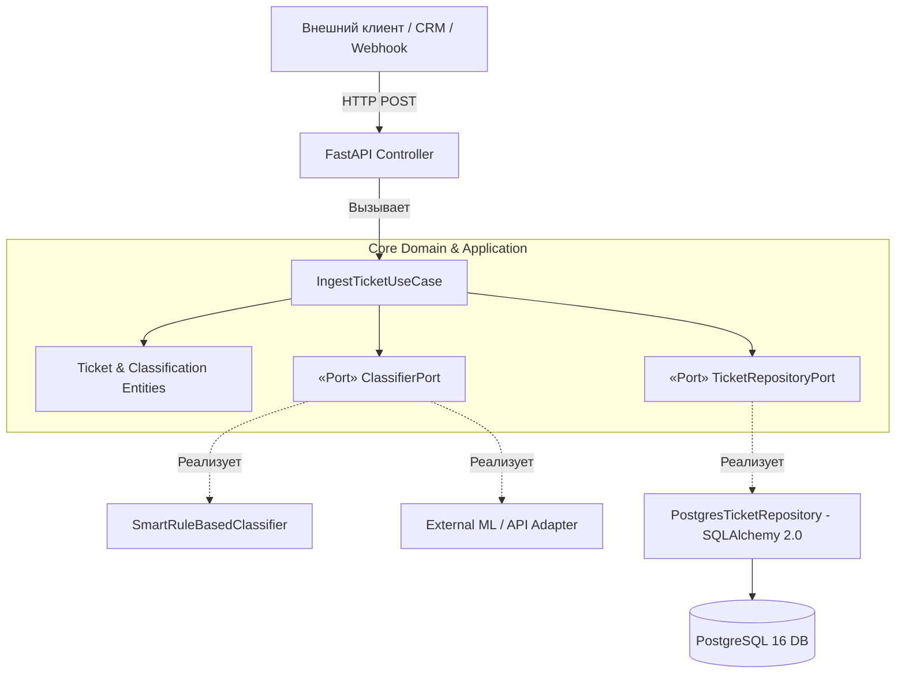
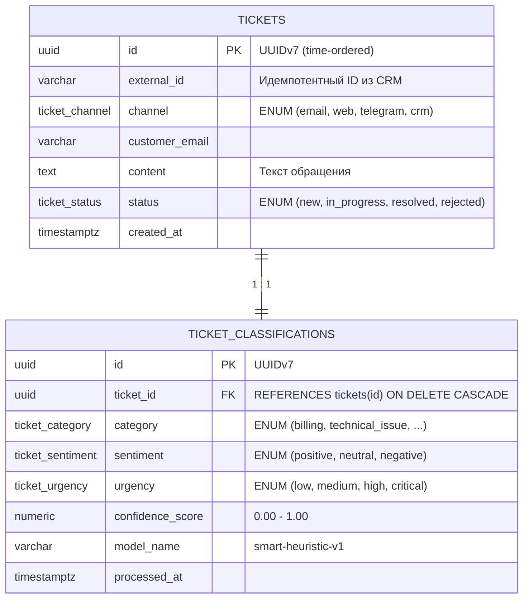

# 🚀 TicketFlow

> **High-Performance Customer Support Categorization & Analytics Microservice**  
> Высокопроизводительный асинхронный сервис автоматической категоризации и маршрутизации клиентских обращений, построенный на принципах **Гексагональной архитектуры (Ports & Adapters)**, **FastAPI**, **SQLAlchemy 2.0** и **PostgreSQL 16**.

[](https://www.python.org/)
[](https://fastapi.tiangolo.com)
[](https://www.postgresql.org/)
[](https://docs.pytest.org/)
[](#архитектура)

---

## 📌 Ключевые возможности

1. **Автоматизация бизнес-процессов (Webhooks):**
   * Прием входящих обращений клиентов из CRM, мессенджеров (Telegram), форм и email.
   * Идемпотентность вебхуков по `external_id`: повторные вызовы не дублируют обращения и гарантируют консистентность очереди.
2. **Интеллектуальная классификация и маршрутизация:**
   * Определение **категории** (`billing`, `technical_issue`, `account_access`, `general_feedback`).
   * Определение **тональности (sentiment)** (`positive`, `neutral`, `negative`).
   * Расчет **срочности (urgency)** (`low`, `medium`, `high`, `critical`) и индекса уверенности (confidence score).
   * Расширяемый движок классификации: быстрый детерминированный эвристический анализатор (нулевая задержка, оффлайн) с возможностью подключения внешних ML-моделей.
3. **Аналитические витрины для BI (Superset / Qlik / Metabase):**
   * Эндпоинт агрегированной статистики по категориям, тональности и среднему скору уверенности в реальном времени.
4. **Инженерная культура и надежность:**
   * Полная изоляция ядра предметной области (Domain) от веб-фреймворков и СУБД.
   * Пирамида автоматического тестирования на `pytest` (Unit, API Integration, live PostgreSQL E2E).

---

## 🏗 Архитектура системы (Ports & Adapters)

Сервис спроектирован по канонам чистой гексагональной архитектуры:



### Преимущества архитектуры:
* **Тестируемость:** Юнит-тесты бизнес-логики выполняются за **0.06 секунды** на in-memory моках без необходимости поднимать базу данных.
* **Слабая связанность:** Смена провайдера СУБД или движка классификации осуществляется заменой адаптера без изменения доменного слоя.

---

## 🗄 Архитектура базы данных и оптимизация (PostgreSQL)

Схема нормализована до **3NF**: сырые клиентские данные изолированы от вычисленных результатов анализа.



### Инженерные решения по БД:
1. **UUIDv7 вместо UUIDv4:**
   * UUIDv7 содержит 48-битный временной Unix-штамп в миллисекундах.
   * Строки в B-Tree ложатся последовательно (append-only), что исключает фрагментацию страниц памяти и частые `page splits` при высокой интенсивности записей.
2. **PostgreSQL ENUM:**
   * Компактное хранение (4 байта на поле) и строгая валидация допустимых статусов на уровне движка базы данных.
3. **Индексация:**
   * `(status, created_at)` — для мгновенной выборки свежей очереди заявок операторами.
   * `(category, sentiment)` — для быстрого построения аналитических срезов.
   * `(external_id)` — быстрый B-Tree поиск для проверки идемпотентности.
4. **Готовность к партиционированию:**
   * Благодаря упорядоченности ключей UUIDv7 и полю `created_at`, таблица архитектурно готова к секционированию (`PARTITION BY RANGE (created_at)`).

---

## 🚀 Быстрый старт

### Вариант 1: Запуск через Docker Compose (рекомендуется)

Запуск базы данных:

```bash
docker-compose up -d postgres
```

Запуск приложения локально:
```bash
source .venv/bin/activate
uvicorn src.adapters.api.app:app --reload --port 8000
```

* Swagger UI (интерактивная документация): [http://localhost:8000/docs](http://localhost:8000/docs)
* Healthcheck: [http://localhost:8000/health](http://localhost:8000/health)

---

## 🧪 Запуск тестов

Тестовый набор включает модульные тесты предметной области, интеграционные тесты API и E2E тесты с PostgreSQL:

```bash
# Активируйте окружение и запустите pytest
pytest -v
```

Пример вывода:
```text
tests/integration/test_api.py::test_health_endpoint PASSED
tests/integration/test_api.py::test_create_ticket_webhook_success PASSED
tests/integration/test_api.py::test_get_ticket_by_id_and_not_found PASSED
tests/integration/test_api.py::test_analytics_summary_endpoint PASSED
tests/integration/test_postgres_e2e.py::test_live_postgres_flow PASSED
tests/unit/test_use_cases.py::test_ingest_ticket_flow PASSED
tests/unit/test_use_cases.py::test_ingest_ticket_idempotency PASSED
tests/unit/test_use_cases.py::test_analytics_summary_calculation PASSED

8 passed in 1.15s
```

---

## 📡 Примеры API-запросов

### 1. Вебхук входящего обращения (`POST /api/v1/tickets/webhook`)

```bash
curl -X POST "http://localhost:8000/api/v1/tickets/webhook" \
     -H "Content-Type: application/json" \
     -d '{
       "content": "I was double charged for my monthly subscription! Please refund ASAP.",
       "channel": "web",
       "customer_email": "alex@example.com",
       "external_id": "CRM-PAY-991"
     }'
```

**Ответ (201 Created):**
```json
{
  "id": "0194cd81-f09d-7a2e-8c45-420efc023419",
  "channel": "web",
  "content": "I was double charged for my monthly subscription! Please refund ASAP.",
  "status": "new",
  "external_id": "CRM-PAY-991",
  "customer_email": "alex@example.com",
  "created_at": "2026-10-28T02:00:00Z",
  "classification": {
    "id": "0194cd81-f0a0-761a-96dc-80bc71d4400e",
    "category": "billing",
    "sentiment": "negative",
    "urgency": "critical",
    "confidence_score": 0.93,
    "model_name": "smart-heuristic-v1",
    "processed_at": "2026-10-28T02:00:00Z"
  }
}
```

### 2. Сводная аналитика для BI (`GET /api/v1/analytics/summary`)

```bash
curl -X GET "http://localhost:8000/api/v1/analytics/summary"
```

**Ответ (200 OK):**
```json
{
  "total_tickets": 150,
  "by_category": {
    "billing": 65,
    "technical_issue": 52,
    "account_access": 25,
    "general_feedback": 8
  },
  "by_sentiment": {
    "negative": 84,
    "neutral": 46,
    "positive": 20
  },
  "by_urgency": {
    "critical": 18,
    "high": 62,
    "medium": 45,
    "low": 25
  },
  "avg_confidence": 0.91
}
```
